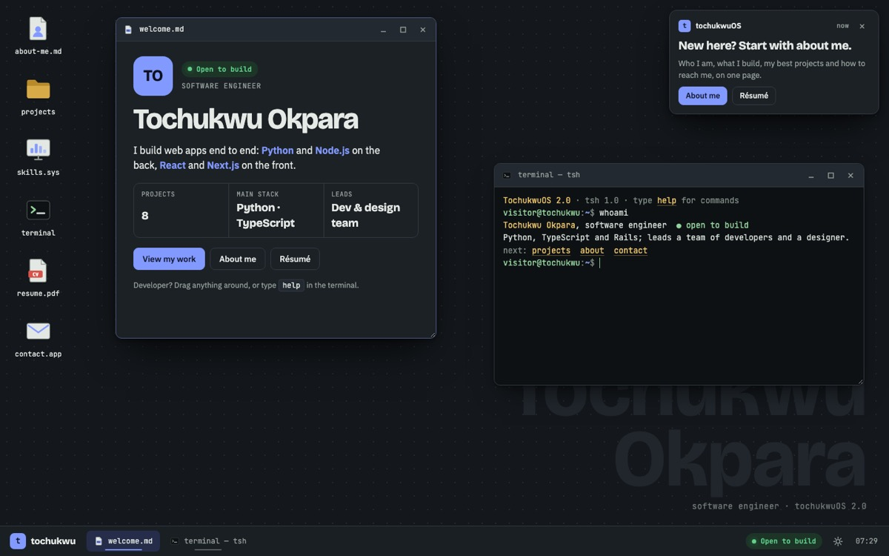

# TochukwuOS: my portfolio as a desktop

## Description
> My personal portfolio, built as a small desktop operating system in the browser. Visitors get a one-page about-me up front; developers can drag windows around, browse projects in a file explorer and use a working terminal.

## Features

- **About me:** a welcome pop-up and an `about-me.md` window with who I am, best projects, publication, background, stack, résumé and contact in one place
- **Draggable desktop:** icons and windows you can move, resize, minimize and maximize, with a taskbar and start menu
- **Project explorer:** each project opens as a case study with a swipeable screenshot slider, highlights, stack and live/source links
- **Shareable links:** `/#scandiweb-store`, `/#about` or any project id opens that window straight away
- **Working terminal:** `help`, `ls`, `cd`, `open`, `cat`, `projects`, `skills`, `neofetch`, `sudo hire-me` and more, with tab completion and history
- **Skills monitor:** technologies counted from real projects rather than self-ratings
- **Phone layout:** under 720px the desktop becomes a home screen and each window opens full screen
- **Light and dark themes**, plus a classic single-page view in the start menu

All content lives in [`js/data.js`](./js/data.js), so adding or removing a project is a one-place change.

## Built With

- HTML
- CSS
- JavaScript (ES modules, no framework or build step)

## Run it locally

ES modules need a local server, so opening `index.html` directly from disk won't work.

- `git clone https://github.com/xtrahuman/portfolio_website.git`
- `cd portfolio_website`
- `python3 -m http.server 8080`
- open http://localhost:8080

Lint with `npm install`, then `npx eslint .` and `npx stylelint "**/*.css"`.

## Project link

[Live site](https://xtrahuman.github.io/portfolio_website/)

## Author

👤 **Tochukwu Okpara**

- GitHub: [@xtrahuman](https://github.com/xtrahuman)
- Twitter: [@xtrahuman](https://twitter.com/xtrahuman)
- LinkedIn: [LinkedIn](https://www.linkedin.com/in/tochukwuokpara/)

## 🤝 Contributing

Contributions, issues, and feature requests are welcome!

Feel free to check the [issues page](../../issues/).

## Show your support

Give a ⭐️ if you like this project!

## 📝 License

This project is [MIT](./LICENSE) licensed.
